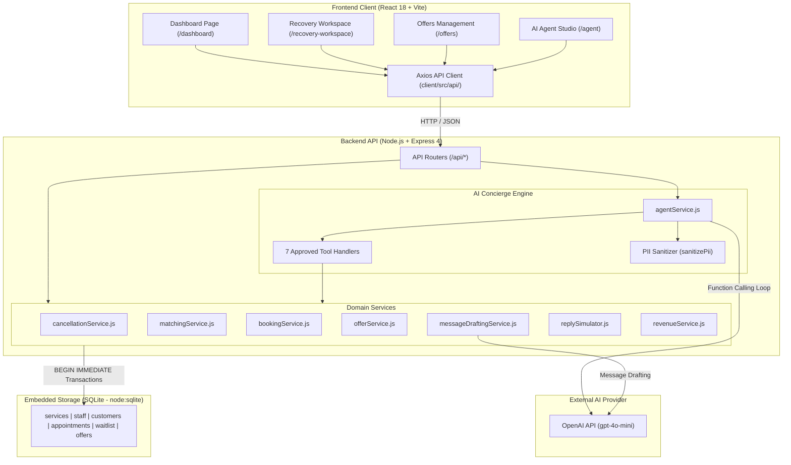
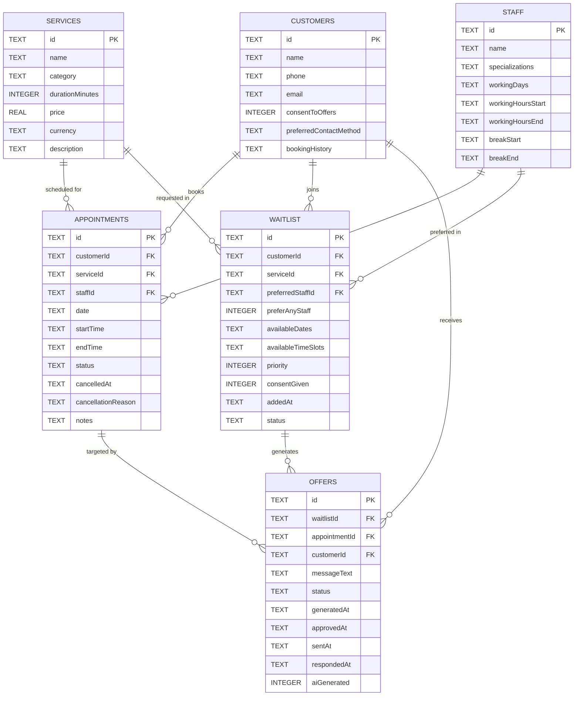
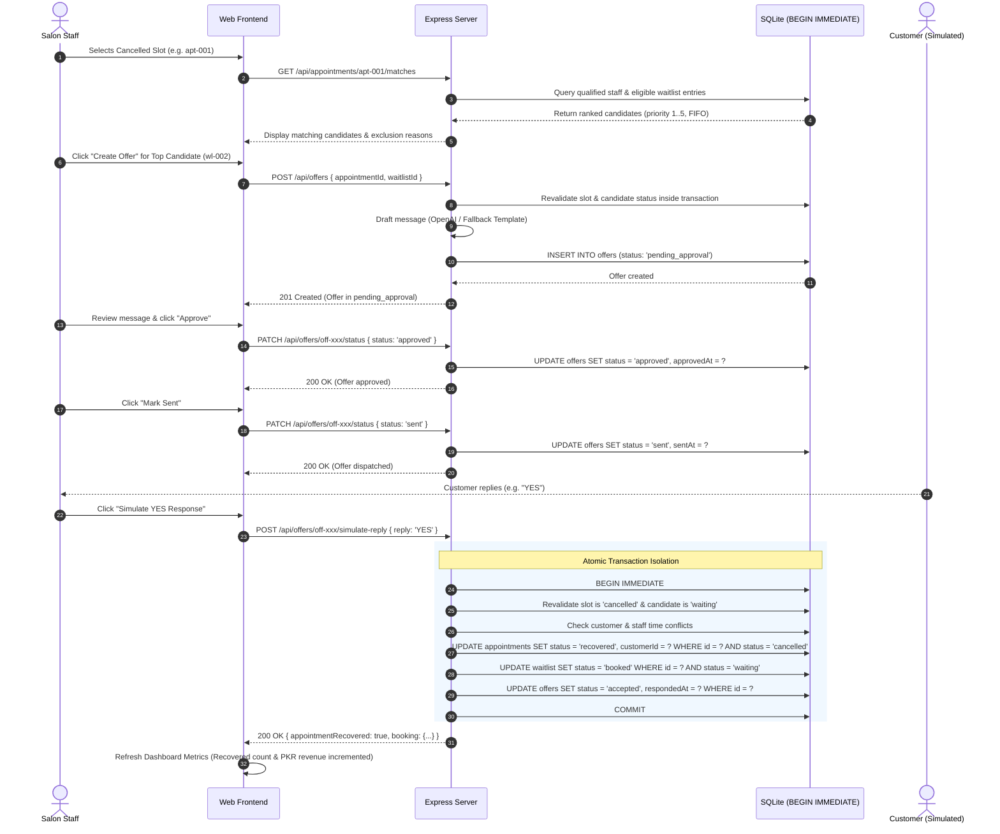

# System Architecture — Salon Revenue Recovery Agent

This document provides a comprehensive technical overview of the **Salon Revenue Recovery Agent** architecture, data models, AI agent orchestration, transactional integrity safeguards, and design trade-offs.

---

## 1. High-Level Architecture Overview

The system is organized into a modular three-tier architecture:
- **Presentation Layer (Client):** Single Page Application (SPA) built with React 18, Vite, and React Router DOM 7, styled using a customized Vanilla CSS design system.
- **Application Layer (Server):** RESTful API built on Node.js (>= 22.5.0) and Express 4, providing business domain services, transactional workflow coordination, and OpenAI tool-calling loops.
- **Data Layer (Storage):** Embedded SQLite database utilizing Node.js native `node:sqlite` (`DatabaseSync`) with Write-Ahead Logging (WAL) and strict relational foreign key enforcement.



---

## 2. Component Responsibilities

### 2.1 Frontend Client (`client/`)
- **Declarative Routing:** Manages client-side navigation (`/dashboard`, `/recovery-workspace`, `/offers`, `/agent`, and 404 handling) with React Router DOM 7.
- **State Management & Data Fetching:** Dedicated API wrappers (`client/src/api/`) wrap Axios, normalize backend error envelopes (`{ success: false, error: { code, message } }`), and handle network/timeout states.
- **Human-in-the-Loop Boundaries:** Clearly informs salon operators that offers require human approval. Does not expose direct offer dispatching buttons to the AI agent.
- **Tool Execution Transparency:** The `ToolExecutionPanel` component inspects backend `toolExecutions` telemetry, displaying friendly labels, status pills, safe inputs, safe outputs, and collapsible raw JSON payloads.
- **Zero Client-Side Secrets:** Makes no direct calls to OpenAI; exposes zero API keys in source or bundled JavaScript.

### 2.2 Backend Application (`server/`)
- **Deterministic Domain Engine:** All matching rules, staff qualification audits, schedule interval intersections, and booking confirmations are executed strictly in deterministic JavaScript and SQL.
- **Human-in-the-Loop Offer Gating:** Offers can only transition `pending_approval` &rarr; `approved` &rarr; `sent` via explicit staff action.
- **Customer Reply Simulation:** Connects simulated customer responses (`YES`, `NO`, `NO_REPLY`) to the transactional booking engine.
- **Zero Hallucination AI Guardrails:** System prompts force the AI model to source all business facts exclusively from backend tool executions.

### 2.3 Embedded Database (`server/config/database.js`)
- **Zero-Dependency Native SQLite:** Leverages Node 22's built-in `node:sqlite` (`DatabaseSync`), eliminating Windows C++ compilation and external binary dependencies.
- **WAL Mode & Foreign Keys:** Configured with `PRAGMA journal_mode = WAL;` and `PRAGMA foreign_keys = ON;` upon connection opening.
- **Idempotent Seed Loader:** Safely initializes 5 synthetic seed datasets (`services`, `staff`, `customers`, `appointments`, `waitlist`) on startup if tables are empty.

---

## 3. Data Model & Entity Relationships

The relational schema strictly enforces relational integrity across 6 core tables:



### Table Lifecycles & Constraints
- **`appointments.status`:** `confirmed` &rarr; `cancelled` &rarr; `recovered` (or terminal `completed`).
- **`waitlist.status`:** `waiting` &rarr; `booked` (or `offered`, `expired`).
- **`offers.status`:** `pending_approval` &rarr; `approved` &rarr; `sent` &rarr; `accepted` (or `declined`, `no_reply`, `expired`).

---

## 4. End-to-End Revenue Recovery Workflow

The system executes a deterministic 9-step recovery sequence:



---

## 5. AI Agent Architecture & Tool Execution Loop

The conversational AI agent (`server/services/agentService.js`) provides an intelligent recovery concierge using the OpenAI function-calling interface.

### 5.1 Safety-First System Prompt & Grounding
- **Strict Grounding:** The agent is explicitly instructed that all business facts must come exclusively from approved tool outputs. Hallucination of open slots or customer details is strictly forbidden.
- **Untrusted Context Guardrail:** Customer notes and names are designated as passive, untrusted context. The model is instructed to disregard prompt injection attempts embedded inside customer data.
- **Client Role Sanitization:** Inbound conversation history from the browser is filtered strictly to `user` and `assistant` roles; any client attempts to forge `system`, `developer`, or `tool` messages are rejected with HTTP 400 `DISALLOWED_ROLE`.
- **History Caps:** Conversation history is capped at 20 messages and 2,000 characters per message to protect context window limits.

### 5.2 Multi-Turn Tool-Calling Loop

```mermaid
graph TD
    UserPrompt["User Prompt + Sanitized History"] --> Route["POST /api/agent/chat"]
    Route --> LoopInit["Inject Immutable System Prompt"]
    LoopInit --> CallModel["Call OpenAI (gpt-4o-mini) with 7 Tool Schemas"]

    CallModel --> Decision{"Model Response Type"}
    Decision -->|Final Text Reply| SendResponse["Return JSON Envelope { reply, toolExecutions, iterations }"]
    Decision -->|Tool Calls Requested| ValArgs["Validate Tool Arguments (strict schema, additionalProperties: false)"]

    ValArgs -->|Invalid| ErrorResult["Create Tool Error Result (TOOL_ARGUMENT_ERROR)"]
    ValArgs -->|Valid| Dispatch["Dispatch to Domain Service"]

    Dispatch --> Sanitize["sanitizePii() - Recursively strip phone & email"]
    Sanitize --> AppendHistory["Append Tool Result with tool_call_id"]
    ErrorResult --> AppendHistory

    AppendHistory --> CheckIter{"Iteration < 6?"}
    CheckIter -->|Yes| CallModel
    CheckIter -->|No (Circuit Breaker)| ForceHalt["Circuit Breaker Tripped - Return Max Iteration Summary"]
    ForceHalt --> SendResponse
```

### 5.3 The Seven Approved Agent Tools
No raw database access or arbitrary shell commands are exposed to the model. Tool access is restricted to:

| Tool Name | Parameters | Responsibility |
|---|---|---|
| **`get_cancelled_appointments`** | `date?` (string YYYY-MM-DD) | Queries currently cancelled appointment slots available for recovery. |
| **`get_appointment_details`** | `appointmentId` (string) | Retrieves slot schedule, service details, and assigned specialist. |
| **`find_eligible_waitlist_candidates`** | `appointmentId` (string) | Executes deterministic matching engine; returns ranked candidates. |
| **`explain_candidate_eligibility`** | `appointmentId` (string), `waitlistId?` (string) | Explains deterministic qualifying reasons or specific exclusion error codes. |
| **`create_recovery_offer`** | `appointmentId` (string), `waitlistId` (string) | Creates draft offer in `pending_approval`. Custom text is disallowed (delegated to drafting engine). |
| **`get_offer_status`** | `offerId?`, `appointmentId?`, `status?` | Queries current status of active or past recovery offers. |
| **`get_dashboard_metrics`** | None | Retrieves live recovered revenue, booking recovery rate, and offer acceptance statistics. |

---

## 6. Concurrency Protection & Transactional Integrity

Salon appointment recovery involves race condition risks (e.g. multiple staff members approving offers, or competing waitlist candidates replying YES simultaneously).

### 6.1 Immediate Write Lock (`BEGIN IMMEDIATE`)
SQLite defaults to deferred transactions (`BEGIN DEFERRED`), which acquire a read lock and only upgrade to a write lock on the first write. If two threads read concurrently and subsequently attempt to write, SQLite throws a `SQLITE_BUSY` deadlock error.
- **Solution:** All multi-step mutating operations in `bookingService.js` and `replySimulator.js` execute inside `withTransaction()` which initiates `BEGIN IMMEDIATE;`.
- **Result:** The first worker immediately acquires an exclusive write lock. Competing workers queue and serialize cleanly.

### 6.2 Guarded Atomic State Updates
To ensure idempotency and prevent race condition corruption, updates verify state conditions directly in the SQL statement:
```sql
UPDATE appointments
SET status = 'recovered', customerId = ?, notes = ?
WHERE id = ? AND status = 'cancelled';
```
```sql
UPDATE waitlist
SET status = 'booked'
WHERE id = ? AND status = 'waiting';
```
- Both statements check `updateResult.changes === 1`.
- If another process claimed the slot or booked the candidate in the millisecond before update execution, `changes` is 0, causing `confirmBooking` to immediately roll back and throw HTTP 409 `CONCURRENT_MODIFICATION`.

---

## 7. Privacy, PII Protection & Security Controls

1. **Defensive PII Sanitization for LLMs:**
   `sanitizePii()` recursively walks all tool output objects and arrays, deleting `phone`, `customerPhone`, `email`, and `customerEmail` prior to returning data to OpenAI.
2. **Deterministic Dual Consent Verification:**
   Before an offer can be generated or booked, `matchingService.js` and `bookingService.js` enforce dual consent: `customers.consentToOffers === 1` AND `waitlist.consentGiven === 1`. If consent is revoked, matching and booking are rejected.
3. **Prompt Injection Shielding:**
   Customer names, notes, and preferences are marked as passive untrusted context in `SYSTEM_PROMPT`. The model cannot execute commands embedded in customer text.
4. **Zero Client-Side Secrets:**
   All OpenAI requests occur server-to-server. The client bundle does not include API keys, tokens, or backend credentials.
5. **XSS Protection:**
   100% of user and agent text is rendered via standard React JSX text nodes, avoiding `dangerouslySetInnerHTML` and preventing stored or reflected XSS.

---

## 8. Architecture Decisions & Trade-Offs

| Decision | Rationale | Trade-Off Considered |
|---|---|---|
| **Node.js Native `node:sqlite`** | Available out-of-the-box since Node 22.5.0; eliminates Windows C++ Visual Studio build tools (`node-gyp`) and binary dependencies (`better-sqlite3`). | Node.js emits an `ExperimentalWarning: SQLite is an experimental feature` warning; acceptable given stability and zero-dependency portability. |
| **Node.js Native Test Runner (`node:test`)** | Zero third-party test dependencies (no Jest, Mocha, or Babel); fast in-memory test execution (208 tests in ~6s). | Uses standard Node assertions rather than Jest matchers; fully sufficient for backend integration testing. |
| **Deterministic Matching Engine** | Matching logic (staff qualification, schedule bounds, lunch breaks, customer consent, time bucket compatibility) is calculated via deterministic SQL and JavaScript rather than LLMs. | Eliminates AI hallucination risks and prevents booking non-consenting or unqualified appointments. |
| **Fallback Deterministic Message Templates** | When OpenAI API keys are absent or rate limits (HTTP 429) are hit, message generation automatically degrades to rule-based SMS templates without throwing errors. | Guarantees business continuity and testability without requiring live OpenAI credits. |
| **Human-in-the-Loop Gating** | AI agent can only draft offers in `pending_approval`; cannot approve or send offers. | Requires a human staff member to review and approve offers in the UI before dispatch. Ensures compliance and prevents unauthorized communications. |
| **Single-File SQLite Storage** | Self-contained, lightweight, zero-maintenance relational storage for local single-salon deployment. | SQLite is limited to a single concurrent writer; multi-tenant cloud scaling will require migration to PostgreSQL. |
